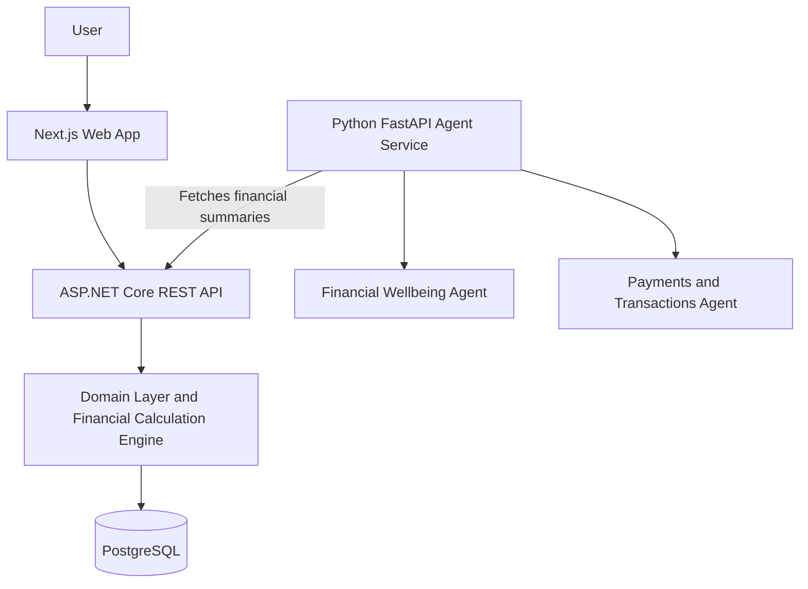

<div align="center">

# InclusiV

**Financial guidance, made more accessible.**

An independent financial inclusion platform exploring how practical financial tools and coordinated specialist agents can help students and job seekers understand their money, build healthier financial habits and make more informed decisions.


</div>

InclusiV is being developed around a simple idea: financial tools should be easier to understand and more useful to people who are studying, looking for work or managing irregular income.

The project combines a financial-records API, a calculation layer and a Python agent service. The current implementation focuses on the backend foundation and early agent workflows; the web interface and several planned integrations are still in progress.

## Why I built it

Managing money can be especially difficult when income is limited or unpredictable. It is not always enough to record transactions — people also need a clearer picture of their spending, practical ways to plan a budget and support in understanding their options.

I wanted to explore how software engineering and AI-assisted workflows could bring those pieces together in one platform, while keeping the financial calculations and transaction records in a dedicated backend.

## What is implemented

### Financial records and REST API

The ASP.NET Core API currently provides endpoints for:

- **User profiles** — create, retrieve and update a user's basic profile.
- **Financial accounts** — create and retrieve accounts, calculate balances and delete accounts.
- **Transactions** — record income and expenses, retrieve transactions with filters, update transaction status and delete records.
- **Budgets** — create category-based monthly budgets, retrieve budget status, update limits and delete budgets.
- **Savings goals** — create and update goals, record contributions and retrieve progress.
- **Financial summaries** — combine account, transaction, budget and savings information for a selected month.

The API uses Entity Framework Core with PostgreSQL persistence and database migrations.

### Financial calculation engine

The domain layer contains a dedicated calculation engine for:

- Account balances, with handling for pending and failed transactions.
- Monthly income, expenses and net cash flow.
- Expense breakdowns by category.
- Budget usage, remaining amounts and budget health.
- Savings-goal progress and suggested monthly contributions.
- Consolidated monthly financial summaries.

Keeping these calculations in the domain layer separates financial rules from the HTTP endpoint implementation.

### Python agent service

The FastAPI service currently exposes two active agent workflows:

**Financial Wellbeing Agent**
- Reviews a user's financial summary.
- Identifies negative cash flow and zero-buffer situations.
- Highlights budgets that are approaching or exceeding their limits.
- Explains spending by category.
- Provides rule-based budgeting and savings suggestions.

**Payments and Transactions Agent**
- Provides an educational payment simulation endpoint.
- Validates the recipient and payment amount.
- Returns a simulated transaction reference and result.
- Offers a basic conversational route for payment-related prompts.

The service also exposes an agent directory endpoint. Insurance guidance and financial research are listed as planned agents, not completed integrations.

> **Implementation note:** The current agent logic is rule-based. It does not call an external LLM, and the payment simulator does not move real money or connect to a live payment provider.

## Architecture

The repository is organised into three application areas, supported by PostgreSQL and Docker Compose.



The agent service can receive financial context directly in a request or retrieve a user's financial summary from the .NET API through its backend client.

## Technology stack

| Area | Technologies |
|---|---|
| **Web application** | Next.js 15, React 19, TypeScript |
| **Backend API** | C#, ASP.NET Core, .NET 10 |
| **Domain and persistence** | Entity Framework Core, Npgsql |
| **Database** | PostgreSQL 16 |
| **Agent service** | Python 3.11+, FastAPI, Pydantic, HTTPX |
| **API communication** | REST, JSON |
| **Infrastructure** | Docker, Docker Compose |
| **Cloud foundation** | Azure Bicep (initial infrastructure template) |

## Run locally

### Prerequisites

- Docker Desktop with Docker Compose
- Git

For running individual services outside Docker, install:
- .NET 10 SDK
- Python 3.11 or newer
- Node.js 22 or newer
- pnpm

### 1. Clone the repository

```bash
git clone https://github.com/ZinhleHlongwane/InclusiV.git
cd InclusiV
```

### 2. Configure environment variables

Create your local environment file:

```bash
cp .env.example .env
```

The example values are intended for local development. Update them if your local environment uses different database credentials or ports.

### 3. Start the application

```bash
docker compose up --build
```

Docker Compose starts PostgreSQL, the .NET API, the Python agent service and the Next.js web application.

### 4. Local service addresses

| Service | URL |
|---|---|
| Web application | http://localhost:3000 |
| .NET API health check | http://localhost:8080/health |
| Agent service health check | http://localhost:8000/health |
| PostgreSQL | localhost:5432 |

Stop the services with:

```bash
docker compose down
```

To remove the local PostgreSQL volume as well:

```bash
docker compose down -v
```

**Warning:** Removing the volume deletes the local database data.

## API overview

The current .NET API exposes the following route groups:

| Resource | Base route | Purpose |
|---|---|---|
| Users | `/api/users` | Create, retrieve and update user profiles |
| Accounts | `/api/accounts` | Manage financial accounts and balances |
| Transactions | `/api/transactions` | Record and query income and expenses |
| Budgets | `/api/budgets` | Manage monthly category budgets |
| Savings goals | `/api/savings-goals` | Track savings targets and contributions |
| Financial summary | `/api/financial-summary` | Retrieve a consolidated monthly summary |

The agent service exposes:

| Method | Route | Purpose |
|---|---|---|
| GET | `/health` | Agent service health check |
| GET | `/v1/agents` | List available agents and their current status |
| POST | `/v1/agents/financial-wellbeing/advice` | Generate rule-based financial guidance |
| POST | `/v1/agents/financial-wellbeing/explain-spending` | Explain spending for a category |
| POST | `/v1/agents/payments/simulate` | Simulate an educational sandbox payment |
| POST | `/v1/chat` | Route a basic chat request to an available workflow |

## Repository structure

```text
InclusiV/
├── agents/
│   ├── src/platform_agents/
│   │   ├── agents/              # Financial wellbeing and payment logic
│   │   ├── client.py            # .NET API client
│   │   ├── models.py            # Pydantic request and response models
│   │   ├── routes.py            # FastAPI routes
│   │   └── main.py              # FastAPI application
│   └── pyproject.toml
├── backend/
│   └── dotnet/
│       └── src/
│           ├── Api/              # ASP.NET Core endpoints and persistence
│           └── Domain/           # Financial entities and calculation rules
├── frontend/
│   └── web/                      # Next.js application
├── infra/
│   └── azure/                    # Initial Azure Bicep foundation
├── .env.example
└── docker-compose.yml
```

## Current limitations

InclusiV is an active development project, not a production financial service.

- The web application is currently an early landing-page foundation; the full user-facing financial dashboard and workflows are not complete.
- Agent responses are generated using application rules, not a connected language model.
- The payment workflow is a simulation only. It does not initiate real payments or integrate with MTN MoMo or another live payment provider.
- Insurance guidance and financial research agents are planned.
- Authentication, authorisation and production-grade security controls are not yet implemented.
- The Azure template is an initial infrastructure foundation, not a complete production deployment.
- Do not use the application as a source of regulated financial advice or as a replacement for a financial professional.

Never commit real credentials or personal financial information. Keep local secrets in `.env`, which should remain untracked.

## What's next

- [x] Establish the .NET API and domain-layer foundation.
- [x] Add PostgreSQL persistence with Entity Framework Core.
- [x] Implement core account, transaction, budget and savings-goal endpoints.
- [x] Add monthly financial calculations and summary responses.
- [x] Create the FastAPI agent-service foundation.
- [x] Implement rule-based financial wellbeing guidance.
- [x] Add an educational sandbox payment workflow.
- [ ] Build the complete financial dashboard and connect the web application to the APIs.
- [ ] Add authentication and role-based authorisation.
- [ ] Expand automated tests across API, domain and agent workflows.
- [ ] Add the insurance guidance and financial research workflows.
- [ ] Evaluate safe, grounded LLM integration for conversational assistance.
- [ ] Implement and test external payment-provider integrations in a sandbox environment.
- [ ] Complete and validate the Azure deployment architecture.

---

<div align="center">

Built by [Zinhle Hlongwane](https://github.com/ZinhleHlongwane) · Johannesburg, South Africa 🇿🇦

</div>
