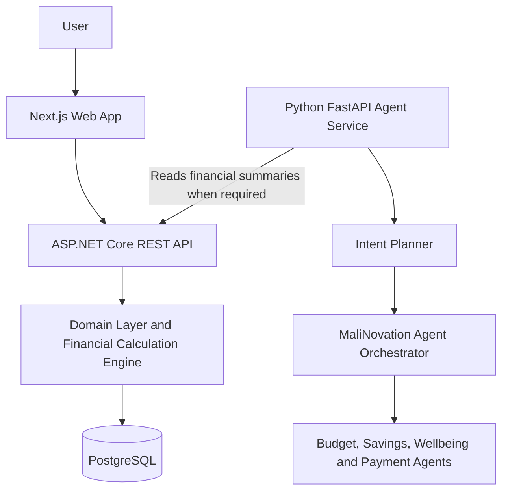

<div align="center">

# MaliNovation

**Rethinking finance. Connecting possibilities.**

An independent financial inclusion platform exploring how practical financial tools and coordinated specialist agents can help students and job seekers understand their money, build healthier financial habits and make more informed decisions.


</div>

MaliNovation is being developed around a simple idea: financial tools should be easier to understand and more useful to people who are studying, looking for work or managing irregular income.

The project combines a financial-records API, a deterministic calculation layer and a Python agent service. The current implementation focuses on the backend foundation and agent workflows; the web interface and several planned integrations are still in progress.

## Why I built it

Managing money can be especially difficult when income is limited or unpredictable. Recording transactions is useful, but people also need a clearer picture of their spending, practical ways to plan a budget and support in understanding their options.

I wanted to explore how software engineering and AI-assisted workflows could bring those pieces together in one platform, while keeping financial calculations and transaction records in a dedicated backend.

## What is implemented

### Financial records and REST API

The ASP.NET Core API currently provides endpoints for:

- **User profiles** — create, retrieve and update a user's basic profile.
- **Financial accounts** — create and retrieve accounts, calculate balances and delete accounts.
- **Transactions** — record income and expenses, retrieve transactions with filters, update transaction status and delete records.
- **Budgets** — create category-based monthly budgets, retrieve budget status, update limits and delete budgets.
- **Savings goals** — create and update goals, record contributions and retrieve progress.
- **Financial summaries** — combine account, transaction, budget and savings information for a selected month.

The API uses Entity Framework Core with PostgreSQL persistence and database migrations.

### Financial calculation engine

The domain layer contains a dedicated calculation engine for account balances, monthly income and expenses, net cash flow, category spending, budget usage and savings-goal progress. Keeping these calculations in the domain layer separates financial rules from HTTP endpoint implementation.

### Python agent service

The FastAPI service includes these specialist workflows:

- **Financial Wellbeing Agent** — rule-based financial insights, spending explanations and practical next steps.
- **Budget Planning Agent** — reviews monthly category budgets, spending limits and potential overspending.
- **Savings & Goals Agent** — reviews savings targets, progress and contribution guidance.
- **Payments and Transactions Agent** — provides an educational sandbox payment simulation; it does not move real money.

The **MaliNovation Agent Orchestrator** coordinates relevant specialist workflows and can combine results. It supports partial failures so one unsuccessful specialist review does not automatically discard other successful results.

### Optional model-assisted intent planning

When configured with an Azure OpenAI deployment, the orchestrator can use a model to classify a chat request into a structured specialist execution plan. The plan is validated against an allowlist before any specialist is invoked.

- Deterministic keyword routing remains available when Azure settings are absent or model planning fails.
- Low-confidence or invalid model output falls back to deterministic routing.
- Ambiguous requests can return a clarification question.
- Payment requests are kept separate from other specialist workflows.
- The model receives the chat message for intent classification only; it is not given financial records or tools.

Automated tests use mocked HTTP responses. A live Azure model deployment must be configured and tested separately before claiming live model inference works.

## Architecture



The .NET API remains responsible for financial records and deterministic calculations. The agent service coordinates specialist workflows; it does not replace backend validation.

## Technology stack

| Area | Technologies |
|---|---|
| Web application | Next.js 15, React 19, TypeScript |
| Backend API | C#, ASP.NET Core, .NET 10 |
| Domain and persistence | Entity Framework Core, Npgsql |
| Database | PostgreSQL 16 |
| Agent service | Python 3.11+, FastAPI, Pydantic, HTTPX |
| API communication | REST, JSON |
| Infrastructure | Docker, Docker Compose |
| Cloud foundation | Azure Bicep (initial infrastructure template) |
| Optional model planning | Azure OpenAI chat completions |

## Run locally

### Prerequisites

- Docker Desktop with Docker Compose
- Git

For running individual services outside Docker, install .NET 10 SDK, Python 3.11 or newer, Node.js 22 or newer and pnpm.

### 1. Clone the repository

```bash
git clone https://github.com/ZinhleHlongwane/MaliNovation.git
cd MaliNovation
```

### 2. Configure environment variables

```bash
cp .env.example .env
```

The example values are intended for local development. Update them if your local environment uses different database credentials or ports.

### 3. Start the application

```bash
docker compose up --build
```

Docker Compose starts PostgreSQL, the .NET API, the Python agent service and the Next.js web application.

### 4. Local service addresses

| Service | URL |
|---|---|
| Web application | http://localhost:3000 |
| .NET API health check | http://localhost:8080/health |
| Agent service health check | http://localhost:8000/health |
| PostgreSQL | localhost:5432 |

Stop the services with `docker compose down`. To remove the local PostgreSQL volume as well, run `docker compose down -v`; this deletes the local database data.

## Optional Azure model configuration

Add these variables to your local repository-root `.env` file only:

```dotenv
AZURE_AI_ENDPOINT=
AZURE_AI_API_KEY=
AZURE_AI_DEPLOYMENT=
AZURE_AI_API_VERSION=2024-10-21
```

Leave them blank to use deterministic routing. Never commit real API keys or put them in `.env.example`. Confirm the selected Azure model supports the configured API version and JSON response format before enabling it.

See [model-assisted planning](agents/MODEL_PLANNING.md) for the request flow, fallback behaviour and data-handling notes.

## API overview

The .NET API exposes route groups for users, accounts, transactions, budgets, savings goals and monthly financial summaries.

The agent service exposes:

| Method | Route | Purpose |
|---|---|---|
| GET | `/health` | Agent service health check |
| GET | `/v1/agents` | List specialist agents and status |
| POST | `/v1/agents/financial-wellbeing/advice` | Generate rule-based financial guidance |
| POST | `/v1/agents/financial-wellbeing/explain-spending` | Explain spending for a category |
| POST | `/v1/agents/budget-planning/plan` | Create a budget review |
| POST | `/v1/agents/savings-goals/review` | Review savings goals |
| POST | `/v1/agents/payments/simulate` | Simulate an educational sandbox payment |
| POST | `/v1/chat` | Plan and coordinate specialist workflows |

## Repository structure

```text
MaliNovation/
├── agents/                 # FastAPI agents and orchestration
├── backend/dotnet/         # ASP.NET Core API and domain layer
├── frontend/web/           # Next.js application foundation
├── infra/azure/            # Initial Azure Bicep foundation
├── docs/                   # Product, architecture and roadmap docs
├── legacy/                 # Archived prototype material
├── .env.example
└── docker-compose.yml
```

## Current limitations

MaliNovation is an active development project, not a production financial service.

- The web application is currently an early landing-page foundation; the full user-facing financial dashboard and workflows are not complete.
- Financial wellbeing, budget and savings guidance currently use application rules rather than generated model advice.
- Model-assisted intent planning is optional and has only been covered by mocked automated tests so far; live Azure inference remains to be configured and verified.
- The payment workflow is a simulation only. It does not initiate real payments or integrate with MTN MoMo or another live payment provider.
- Insurance guidance and financial research agents are planned, not implemented.
- Authentication, authorisation and production-grade security controls are not yet implemented.
- The Azure template is an initial infrastructure foundation, not a complete production deployment.
- Do not use the application as a source of regulated financial advice or as a replacement for a financial professional.

Never commit real credentials or personal financial information. Keep local secrets in `.env`, which should remain untracked.

## What's next

- [x] Establish the .NET API and domain-layer foundation.
- [x] Add PostgreSQL persistence with Entity Framework Core.
- [x] Implement core account, transaction, budget and savings-goal endpoints.
- [x] Add monthly financial calculations and summary responses.
- [x] Create the FastAPI agent-service foundation.
- [x] Implement financial wellbeing, budget-planning and savings-goal workflows.
- [x] Add an educational sandbox payment workflow.
- [x] Add multi-agent orchestration and optional model-assisted intent planning.
- [ ] Configure and verify a live Azure model deployment.
- [ ] Build the complete financial dashboard and connect the web application to the APIs.
- [ ] Add authentication and role-based authorisation.
- [ ] Expand automated tests across API, domain and agent workflows.
- [ ] Implement insurance guidance and financial research workflows.
- [ ] Implement and test external payment-provider integrations in a sandbox environment.
- [ ] Complete and validate the Azure deployment architecture.

---

<div align="center">

Built by [Zinhle Hlongwane](https://github.com/ZinhleHlongwane) · Johannesburg, South Africa 🇿🇦

</div>
